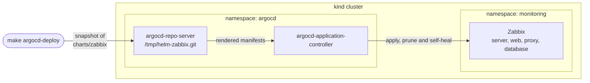

# Test the local Zabbix chart with Argo CD

<!-- TOC -->

- [Test the local Zabbix chart with Argo CD](#test-the-local-zabbix-chart-with-argo-cd)
- [About](#about)
- [How it works](#how-it-works)
- [Versions](#versions)
- [Requirements](#requirements)
- [Installing Argo CD](#installing-argo-cd)
  - [Accessing the Argo CD web interface](#accessing-the-argo-cd-web-interface)
- [Deploy Zabbix using Argo CD](#deploy-zabbix-using-argo-cd)
  - [Testing a change in the chart](#testing-a-change-in-the-chart)
  - [Accessing the Zabbix web interface](#accessing-the-zabbix-web-interface)
  - [Registering the Zabbix proxy](#registering-the-zabbix-proxy)
- [Cleanup](#cleanup)
- [Troubleshooting](#troubleshooting)
- [References](#references)

<!-- TOC -->

# About

This tutorial installs [Argo CD](https://argo-cd.readthedocs.io) with Helm in a local [kind](https://kind.sigs.k8s.io) cluster and uses it to deploy the Zabbix chart of your working directory, including changes that were not committed.

> Attention!!!
> This setup is for testing this chart only. Don't use it in production. In production, Argo CD must read the chart and the values from real repositories.

# How it works

Argo CD reads charts from Git, Helm and OCI repositories. It runs inside the cluster and can't see the files of your computer. For this reason, the ``make argocd-deploy`` command:

1. Copies ``charts/zabbix`` to a temporary directory and commits the files to a temporary Git repository. The Git repository of this project is not changed.
2. Copies this temporary repository to ``/tmp/helm-zabbix.git``, inside the ``argocd-repo-server`` pod.
3. Applies the [application.yaml](application.yaml) file, which reads the chart from ``file:///tmp/helm-zabbix.git``, path ``charts/zabbix``.
4. Waits until the Application is ``Synced`` and ``Healthy``.

The Application uses the same values of the kind example, referencing the path [docs/example/kind/values.yaml](../kind/values.yaml).



Argo CD keeps Zabbix equal to the last snapshot: if you change a resource by hand, Argo CD reverts the change. To test a new version of the chart, send a new snapshot with ``make argocd-deploy``.

# Versions

The versions are defined in the [mise.toml](../../../../../mise.toml) file.

# Requirements

Install the [requirements](../../requirements.md), including Docker, and install the tools with ``mise``:

```bash
cd charts/zabbix
make check-os
make install-deps
make check-deps
```

A kind cluster is required. Create it with the [kind-3nodes.yaml](../kind/kind-3nodes.yaml) file:

```bash
make kind-create
```

Or create the kind cluster and install Argo CD and Zabbix with Helm in a single command. In this case, run ``make undeploy`` before following the [Deploy Zabbix using Argo CD](#deploy-zabbix-using-argo-cd) section:

```bash
make stack-up
```

The commands below use the current cluster of ``kubectl``. Check it before running them. The context of the default kind cluster is ``kind-helm-zabbix``.

```bash
mise exec -- kubectl config current-context
```

# Installing Argo CD

Run in the ``charts/zabbix`` directory:

```bash
make argocd-install
```

This target runs the following command, with the chart version defined in the ``mise.toml`` file:

```bash
helm upgrade --install argocd argo-cd \
  --repo https://argoproj.github.io/argo-helm \
  --version "$ARGOCD_CHART_VERSION" \
  --namespace argocd --create-namespace \
  --wait --timeout 15m
```

List the pods:

```bash
kubectl get pods -n argocd
```

## Accessing the Argo CD web interface

Create a port-forward. It only works while the command is running:

```bash
kubectl -n argocd port-forward svc/argocd-server 8080:443
```

Open https://localhost:8080. The certificate is self-signed, so the browser shows a warning.

The user is ``admin``. In another terminal, get the initial password:

```bash
kubectl -n argocd get secret argocd-initial-admin-secret -o jsonpath="{.data.password}" | base64 -d
```

Optionally, log in with the CLI and show the Application after the deploy:

```bash
argocd login localhost:8080 --username admin --insecure
argocd app get zabbix
```

# Deploy Zabbix using Argo CD

Run in the ``charts/zabbix`` directory:

```bash
make argocd-deploy
```

The ``deploy`` and ``undeploy`` targets continue to install the chart with Helm, without Argo CD. Use only one of the two methods at a time, because both use the name ``zabbix`` in the ``monitoring`` namespace. The ``argocd-deploy`` target fails if the Helm release exists.

> Kubernetes prints the warning ``prefer a domain-qualified finalizer name including a path`` for ``resources-finalizer.argocd.argoproj.io``. It is harmless: this is the [finalizer documented by Argo CD](https://argo-cd.readthedocs.io/en/stable/user-guide/app_deletion/).

Check the status at https://localhost:8080/applications or with:

```bash
kubectl -n argocd get application zabbix
kubectl -n monitoring get pods,svc,pvc
```

## Testing a change in the chart

Change the files in the ``charts/zabbix`` directory and send a new snapshot. There is no need to commit or push:

```bash
make argocd-deploy
```

## Accessing the Zabbix web interface

Create a port-forward and open http://localhost:8888:

```bash
kubectl -n monitoring port-forward svc/zabbix-zabbix-web 8888:80
```

The default user is ``Admin`` and the default password is ``zabbix``.

## Registering the Zabbix proxy

The kind example values enable a Zabbix proxy in active mode. Until you register it, the Zabbix Server log shows ``proxy "zabbix-proxy" not found``. This is expected.

In the web interface go to *Administration → Proxies → Create proxy*, set **Proxy name** to ``zabbix-proxy`` and **Proxy mode** to ``Active``. See the [Zabbix documentation](https://www.zabbix.com/documentation/8.0/en/manual/distributed_monitoring/proxies).

# Cleanup

Remove the Application. Its finalizer makes Argo CD delete the Zabbix resources too:

```bash
make argocd-undeploy
```

The PVC of the PostgreSQL database is kept, so a new deploy reuses the data. To remove it:

```bash
kubectl -n monitoring delete pvc postgresql-data-zabbix-postgresql-0
```

Remove Argo CD and keep the cluster. Its CRDs are kept by default:

```bash
helm uninstall argocd --namespace argocd
```

Or remove the complete stack, deleting the kind cluster:

```bash
make stack-down
```

# Troubleshooting

| Symptom | Cause and solution |
|---|---|
| ``make argocd-deploy`` shows ``Argo CD is not installed`` | Run ``make argocd-install`` |
| ``make argocd-deploy`` shows ``the helm release zabbix already exists`` | Zabbix was installed with Helm, for example by ``make stack-up``. Run ``make undeploy`` |
| ``make deploy`` shows ``invalid ownership metadata`` | Zabbix is managed by Argo CD. Run ``make argocd-undeploy`` |
| Application with ``ComparisonError`` and a message about ``/tmp/helm-zabbix.git`` | The snapshot is only stored in the ``tmp`` directory of the pod and is lost when ``argocd-repo-server`` restarts. Run ``make argocd-deploy`` |
| ``kind create cluster`` fails because of the address already in use | Ports ``80`` and ``443`` of your computer must be free. See the [kind-3nodes.yaml](../kind/kind-3nodes.yaml) file |

# References

- https://argo-cd.readthedocs.io/en/stable/getting_started/
- https://argo-cd.readthedocs.io/en/stable/user-guide/helm/
- https://argo-cd.readthedocs.io/en/stable/operator-manual/tested-kubernetes-versions/
- https://artifacthub.io/packages/helm/argo/argo-cd
- https://kind.sigs.k8s.io/docs/user/quick-start/
- https://mise.jdx.dev/
