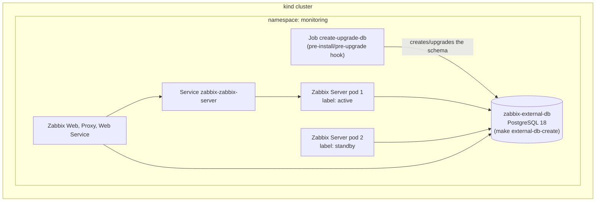

# Test Zabbix Server High Availability in a kind cluster

<!-- TOC -->

- [Test Zabbix Server High Availability in a kind cluster](#test-zabbix-server-high-availability-in-a-kind-cluster)
- [About](#about)
- [Test environment](#test-environment)
- [Requirements](#requirements)
- [Deploy with Helm](#deploy-with-helm)
- [Checking the HA nodes](#checking-the-ha-nodes)
- [Test scenarios](#test-scenarios)
  - [Failover](#failover)
  - [Transition from a standalone Zabbix Server to HA](#transition-from-a-standalone-zabbix-server-to-ha)
  - [Upgrade between Zabbix major versions](#upgrade-between-zabbix-major-versions)
- [Using Argo CD](#using-argo-cd)
- [Testing local images of the HA job and sidecar](#testing-local-images-of-the-ha-job-and-sidecar)
- [Cleanup](#cleanup)
- [Troubleshooting](#troubleshooting)

<!-- TOC -->

# About

This tutorial deploys Zabbix with [Native Zabbix Server High Availability](../../../README.md#native-zabbix-server-high-availability) in a local [kind](https://kind.sigs.k8s.io) cluster, with Helm or with Argo CD, and shows how to test the main scenarios: installation, failover, transition from a standalone Zabbix Server to HA and upgrades.

> Attention!!!
> This setup is for testing this chart only. The database is a single PostgreSQL pod, without high availability or backups. In production, use a highly available database, for example managed by the [CNPG](https://cloudnative-pg.io) or [PGO](https://github.com/CrunchyData/postgres-operator) operators.

# Test environment

Zabbix Server HA can't be used with the database of this chart (``postgresql.enabled=true``), because the database must exist before the pre-install/pre-upgrade job that prepares the schema. The ``make external-db-create`` command creates an external PostgreSQL in the same namespace, with the [external-postgresql.yaml](../kind/external-postgresql.yaml) file. The [values-ha.yaml](../kind/values-ha.yaml) file enables HA with 2 Zabbix Server pods and reads the access to the database from the Secret ``zabbix-external-db``.



# Requirements

Install the [requirements](../../requirements.md) and the tools of the ``mise.toml`` file:

```bash
cd charts/zabbix
make check-os
make install-deps
make check-deps
```

The commands below use the current cluster of ``kubectl``. Check it with ``mise exec -- kubectl config current-context``. The context of the kind cluster is ``kind-helm-zabbix``.

# Deploy with Helm

Run in the ``charts/zabbix`` directory. Create the kind cluster and the external database and install Zabbix with HA in a single command:

```bash
make stack-up-ha
```

Or run each step:

```bash
make kind-create
make external-db-create
make deploy VALUES_FILE=docs/example/kind/values-ha.yaml
```

Run the tests of the chart:

```bash
helm test zabbix -n monitoring
```

# Checking the HA nodes

One Zabbix Server pod has the label ``zabbix.com/server-ha-role=active`` and the other ``standby``. The Service of Zabbix Server has only the active pod as endpoint:

```bash
kubectl get pods -n monitoring -l app.kubernetes.io/component=server -L zabbix.com/server-ha-role
kubectl get endpointslices -n monitoring -l kubernetes.io/service-name=zabbix-zabbix-server
```

See the HA nodes known by Zabbix Server. Runtime commands only work in the active node:

```bash
kubectl exec -n monitoring $(kubectl get pods -n monitoring -l zabbix.com/server-ha-role=active -o name) -c zabbix-server -- zabbix_server -R ha_status
```

See the ``ha_node`` table in the database:

```bash
kubectl exec -n monitoring zabbix-external-db-0 -- psql -U zabbix -d zabbix -c "SELECT name, address, status, extract(epoch from now())::int - lastaccess AS seconds_ago FROM ha_node"
```

The ``status`` column is ``0`` for standby, ``1`` for stopped, ``2`` for unavailable and ``3`` for active nodes. A standalone (non-HA) Zabbix Server has an empty ``name`` and status ``3``.

# Test scenarios

## Failover

Delete the active pod. The standby node becomes active and its sidecar changes the label in a few seconds. The Deployment creates a new pod, which becomes standby:

```bash
kubectl delete -n monitoring $(kubectl get pods -n monitoring -l zabbix.com/server-ha-role=active -o name)
kubectl get pods -n monitoring -l app.kubernetes.io/component=server -L zabbix.com/server-ha-role -w
```

## Transition from a standalone Zabbix Server to HA

Install Zabbix without HA in the external database, then upgrade enabling HA. During the upgrade, the job scales the standalone Zabbix Server down and removes it from the ``ha_node`` table. Then Helm creates the 2 Zabbix Server pods in HA mode:

```bash
make undeploy
make external-db-delete external-db-create
helm upgrade --install zabbix . -n monitoring -f docs/example/kind/values-ha.yaml \
  --set zabbixServer.zabbixServerHA.enabled=false --set zabbixServer.replicaCount=1 \
  --set zabbixServer.haNodesAutoClean.enabled=false --wait

# In another terminal, follow the logs of the job, which is created by the next command
kubectl wait --for=create job/zabbix-create-upgrade-db -n monitoring --timeout=300s && \
  kubectl logs -f job/zabbix-create-upgrade-db -n monitoring

make deploy VALUES_FILE=docs/example/kind/values-ha.yaml
```

The logs of the job show:

```text
deployment zabbix-zabbix-server exists, running as upgrade
*** DB schema is up-to-date, checking whether we come from a standalone (non-HA) setup
**** 1 standalone (non-HA) zabbix_server instances seen in the ha_node table within the last 60 seconds
** scaling the deployment zabbix-zabbix-server from 1 to 0 replicas (pods: app.kubernetes.io/component=server,...)
** deleting the rows of standalone zabbix_server nodes from the ha_node table
*** done
```

## Upgrade between Zabbix major versions

Install Zabbix 7.4 with HA, using the job image of Zabbix 7.4, then upgrade to the default version of the chart. The job scales the Zabbix Server pods down, upgrades the schema and Helm starts the pods of the new version:

```bash
make undeploy
make external-db-delete external-db-create
helm install zabbix . -n monitoring -f docs/example/kind/values-ha.yaml \
  --set zabbixImageTag=alpine-7.4-latest \
  --set zabbixServer.zabbixServerHA.dbCreateUpgradeJob.image.tag=7.4-20261009150714 --wait

make deploy VALUES_FILE=docs/example/kind/values-ha.yaml
kubectl exec -n monitoring zabbix-external-db-0 -- psql -U zabbix -d zabbix -tAc "SELECT mandatory FROM dbversion"
```

# Using Argo CD

The ``argocd-deploy`` target deploys a snapshot of the local chart with Argo CD. See the [Argo CD tutorial](../argocd/README.md). The ``ARGOCD_VALUES_FILES`` variable sets the values files of the Application, in order. Use absolute paths:

```bash
make kind-create
make argocd-install
make external-db-create
make argocd-deploy ARGOCD_VALUES_FILES="$PWD/docs/example/kind/values-ha.yaml"
```

Argo CD renders the chart with ``helm template`` and runs the job as a ``PreSync`` hook in each sync. To test the transition from a standalone Zabbix Server to HA with Argo CD, create a values file that disables HA, deploy it and then deploy only the HA values:

```bash
cat > /tmp/ha-disabled.yaml <<'VALUES'
zabbixServer:
  replicaCount: 1
  zabbixServerHA:
    enabled: false
  haNodesAutoClean:
    enabled: false
VALUES

make argocd-deploy ARGOCD_VALUES_FILES="$PWD/docs/example/kind/values-ha.yaml /tmp/ha-disabled.yaml"
make argocd-deploy ARGOCD_VALUES_FILES="$PWD/docs/example/kind/values-ha.yaml"
kubectl -n argocd get application zabbix
```

Use only Helm or only Argo CD at a time: both use the release name ``zabbix`` in the ``monitoring`` namespace. Run ``make undeploy`` before ``make argocd-deploy``, and ``make argocd-undeploy`` before ``make deploy``.

# Testing local images of the HA job and sidecar

The images of the job and of the sidecar are built in other repositories:

- Job: https://github.com/zabbix-community/helm-zabbix-image-db-init-upgrade-job
- Sidecar: https://github.com/zabbix-community/helm-zabbix-image-ha-labels-sidecar

To test a change in these images before publishing them, build them, load them into the kind cluster and use the [values-local-images.yaml](values-local-images.yaml) file after ``values-ha.yaml``:

```bash
# In the clone of helm-zabbix-image-db-init-upgrade-job
make build        # zabbix-server-create-upgrade-db:8.0-local
# In the clone of helm-zabbix-image-ha-labels-sidecar
make build        # zabbix-server-ha-label-manager:local

# In charts/zabbix of this repository
make kind-load IMAGES="zabbix-server-create-upgrade-db:8.0-local zabbix-server-ha-label-manager:local"
helm upgrade --install zabbix . -n monitoring --wait \
  -f docs/example/kind/values-ha.yaml -f docs/example/ha/values-local-images.yaml

# Or with Argo CD
make argocd-deploy ARGOCD_VALUES_FILES="$PWD/docs/example/kind/values-ha.yaml $PWD/docs/example/ha/values-local-images.yaml"
```

After a new image is built and loaded with the same tag, delete the Zabbix Server pods, so they use the new image of the sidecar. The job uses the new image in the next upgrade or sync.

# Cleanup

```bash
# Helm
make undeploy
# or Argo CD
make argocd-undeploy

# Removes the external database and its data
make external-db-delete

# Or remove the complete stack, deleting the kind cluster
make stack-down
```

# Troubleshooting

See the [troubleshooting of Zabbix Server HA](../../../README.md#troubleshooting-zabbix-server-ha).

| Symptom | Cause and solution |
|---|---|
| ``make deploy`` waits and then fails with ``pre-install hooks failed`` | The external database doesn't exist or isn't ready. Run ``make external-db-create`` |
| The job pod has the status ``ErrImageNeverPull`` | The local images were not loaded into the kind cluster. Run ``make kind-load`` |
| The job pod has the status ``ImagePullBackOff`` | The tag of the job image isn't published. Use local images or set ``zabbixServer.zabbixServerHA.dbCreateUpgradeJob.image.tag`` |
